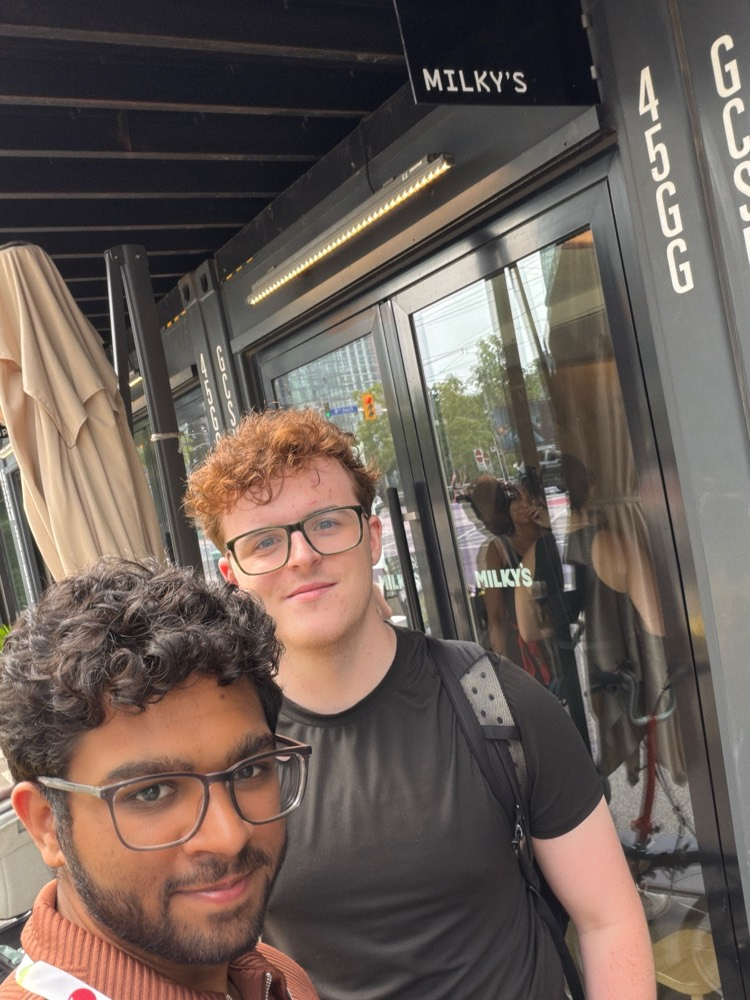
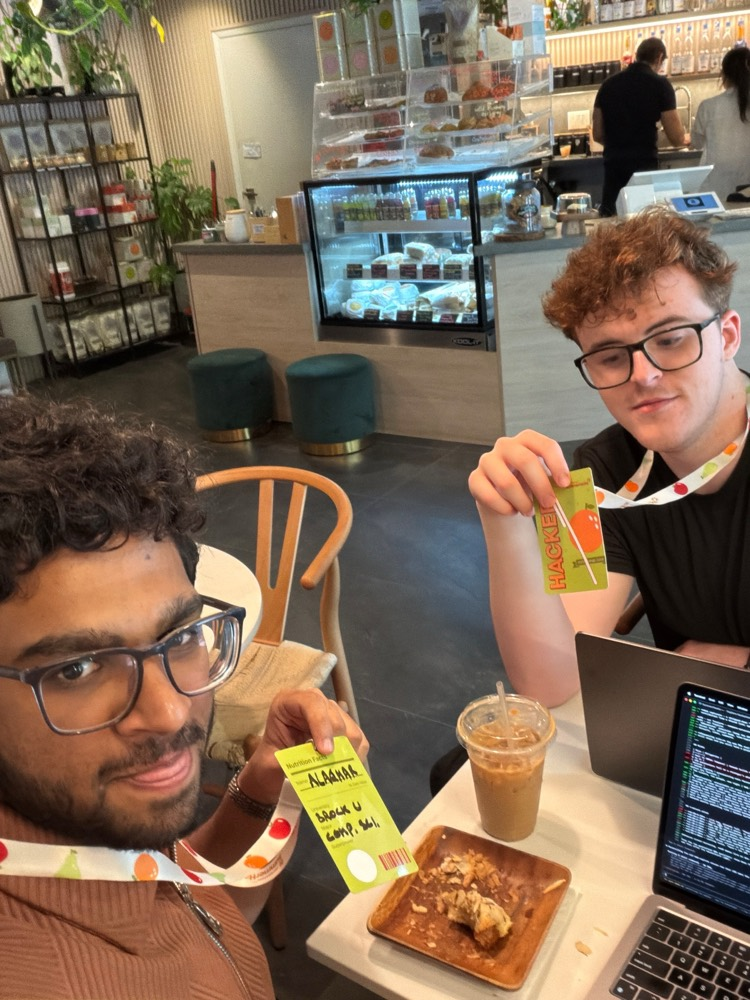
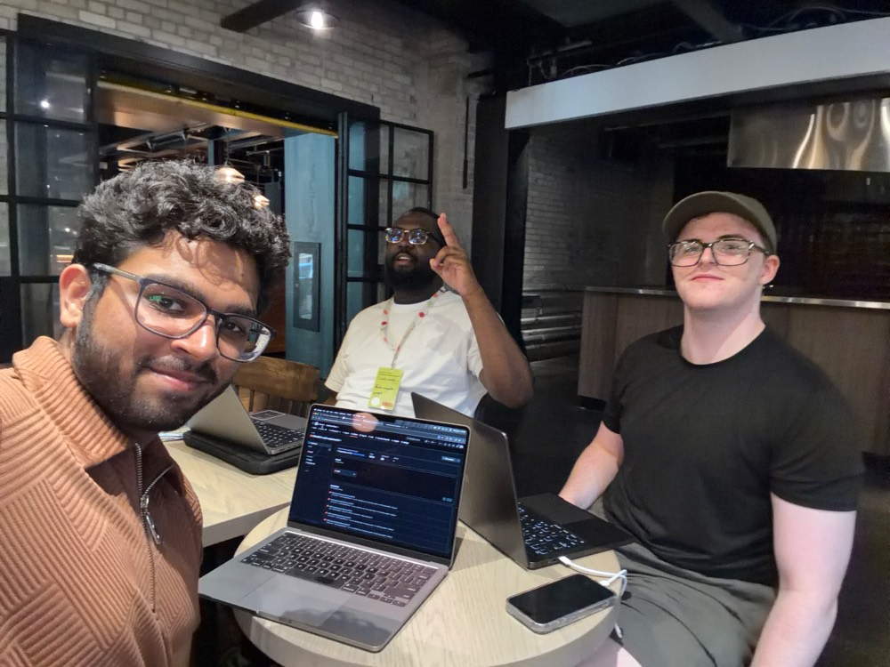
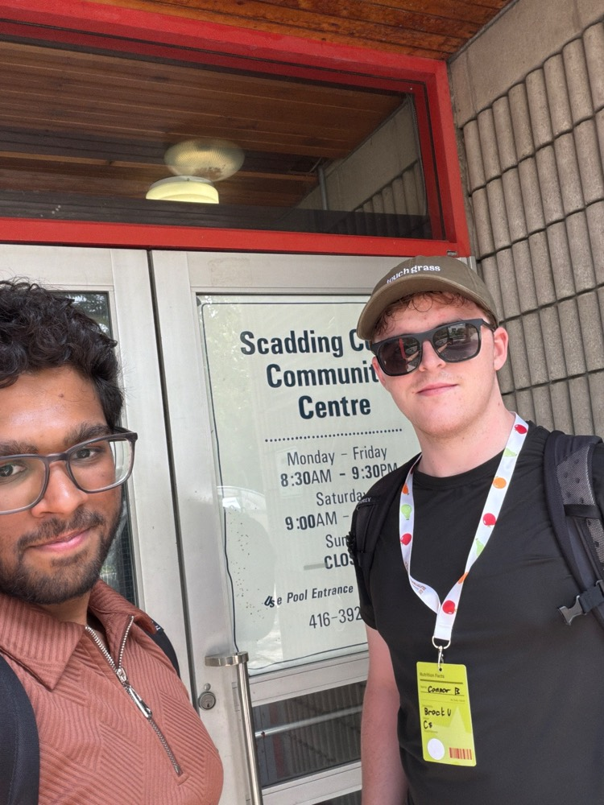

# The Third Space Trek

Side quest for SummerHacks 2026 — one photo per hour, nine spots on the list, 18 points on the board.

**Standing: 🥇 #1 · 8 pts · 4 spots · 4 photos.** Second place is a three-way tie at 6.
Next photo unlocks **3:25 PM**. Team code `FTA8PD` — Alaqmar, Connor.

  

---

## The photos

<table>
<tr>
<td width="33%" align="center"> <b>11:17</b> · Milky's Cloud Room +2 · new spot</td>
<td width="33%" align="center"> <b>12:21</b> · Fungo Cafe +2 · new spot</td>
<td width="33%" align="center"> <b>1:24</b> · Waterworks / The Well +2 · new spot</td>
</tr>
<tr>
<td align="center"> <b>2:25</b> · Scadding Court +2 · new spot</td>
<td align="center"> <b>3:25</b> · TPL Lillian H. Smith</td>
<td align="center"> <b>4:25</b> · TPL Fort York</td>
</tr>
<tr>
<td align="center"> <b>5:25</b> · Botanic Coffee</td>
<td align="center"> <b>6:25</b> · ICHA Tea</td>
<td align="center"> <b>7:25</b> · Varda</td>
</tr>
</table>

> Everyone in frame, lanyards visible, or it doesn't count. Organizers review every photo after
> standings lock. Save new shots to `docs/assets/photos/` as `HHMM-slug.jpg` and swap the
> `_pending.svg` path above.

---

## The route

  

## Schedule

| Time | Stop | Where | Cost | Pts | Ride in |
|---|---|---|---|---:|---|
| ~~11:17~~ | ~~Milky's Cloud Room~~ | Inside Stackt | Purchase | ✅ 2 | — |
| ~~12:21~~ | ~~Fungo Cafe~~ | King St W | Purchase | ✅ 2 | — |
| ~~1:24~~ | ~~Waterworks / The Well~~ | Richmond & Brant | Free | ✅ 2 | — |
| ~~2:25~~ | ~~Scadding Court Community Ctr~~ | Bathurst & Dundas | Free | ✅ 2 | — |
| **3:25** | **TPL Lillian H. Smith** | College & Spadina | Free | 2 | 6 min |
| 4:25 | TPL Fort York Branch | Fort York Blvd | Free | 2 | 11 min |
| 5:25 | Botanic Coffee and Caphe | Queen St W | Purchase | 2 | 8 min |
| 6:25 | ICHA Tea / Project Seoul / Cafe Foret | Chinatown | Purchase | 2 | 6 min |
| 7:25 | Varda | King St W (TIFF) | Purchase | 2 | 8 min |

**8 banked · 10 still on the table · ~39 min of riding left.**

Note the clock drifted: the hourly lock runs off the last submission, so the slot moved 11:17 →
12:21 → 1:24 → 2:25. Assume `:25` for the rest of the day and don't queue up early — the button
won't take it.

## Scoring, as the portal actually counts it

- **New spot — 2 pts.** Anywhere on the list the team hasn't logged yet. "Purchase" is about the
  table, not the score; a café you haven't logged is still worth the full 2.
- **Repeat spot — 1 pt.** Somewhere already logged.
- **Off-list — 1 pt.** Counts, but never earns the discovery bonus.
- **One scoring photo per hour, per team.** The cadence is the ceiling, not the map.

Five unlogged spots remain, so the board maxes out at 18. Everything from here is worth 2 —
there's no reason to repeat a spot while new ones are open.

## Why this order

The one-hour lock is the real constraint, not distance. Walking wouldn't make us miss anything —
it would just burn the 40 minutes we'd otherwise be sitting down with a laptop. Bike Share turns
every leg into ≤12 minutes and hands the rest of each hour back as build time.

Since geography is nearly free on a bike, **closing times decide the order:**

- **3:25 and 4:25 are the last two photo slots before 5 PM**, and the two remaining free stops
  both die at 5 PM. Zero slack. Those slots are spoken for.
- **Fort York has no Sunday recovery.** TPL Sunday hours, where they exist, start at 1:30 PM
  against a 3 PM cutoff.
- The three cafés are the buffer. If anything slips tonight, let it be one of those.

**Best build block:** 3:35–5:00, two libraries back to back, tables and power and wifi, interrupted
only by a photo we're standing next to anyway.

## Bike Share notes

- Day pass, not single trips — six rides each pays for itself around ride four.
- Classic bikes only; e-bikes bill per-minute on top of the pass for no gain over 1.5 km.
- Every leg is well under the 30-min free window, so docking costs nothing extra.
- Dundas/Spadina and Queen W stations fill up Saturday evening. Keep 10 min of margin on the
  5:25 and 6:25 legs and have a backup dock picked.

## Sunday fallback

Five slots exist Sunday (10:25 → 2:25) but **only cafés will be open in them.** Both remaining free
stops have to be logged Saturday.
