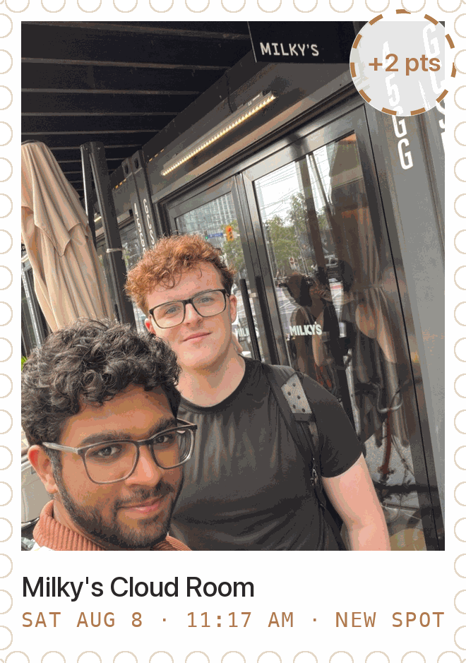
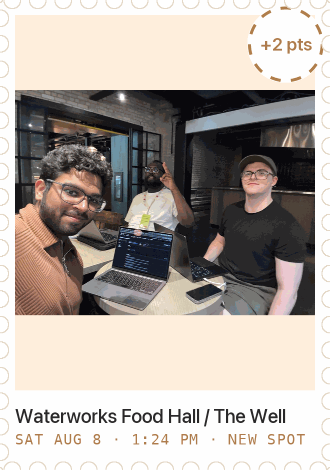
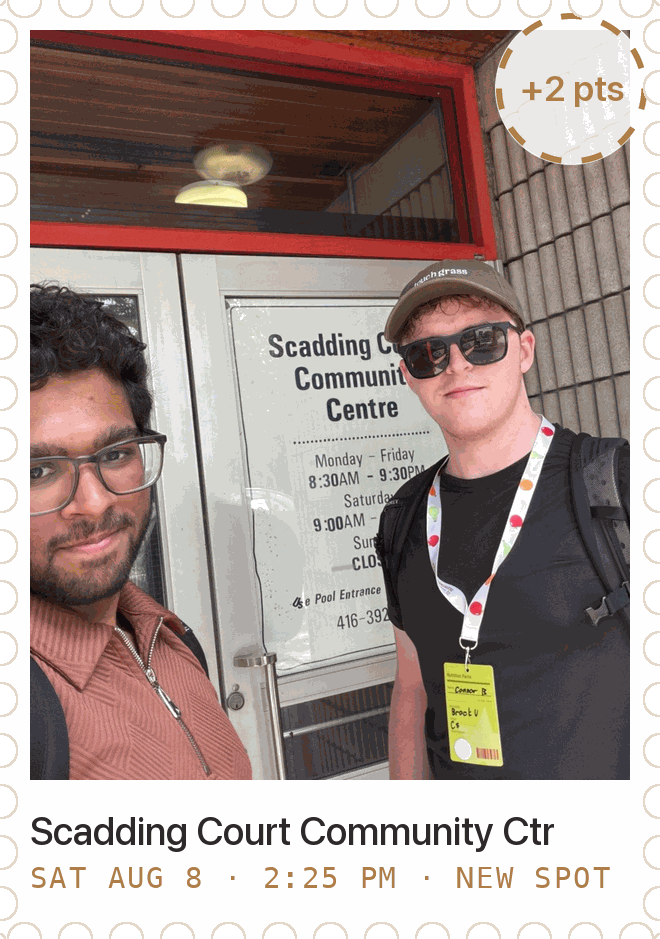
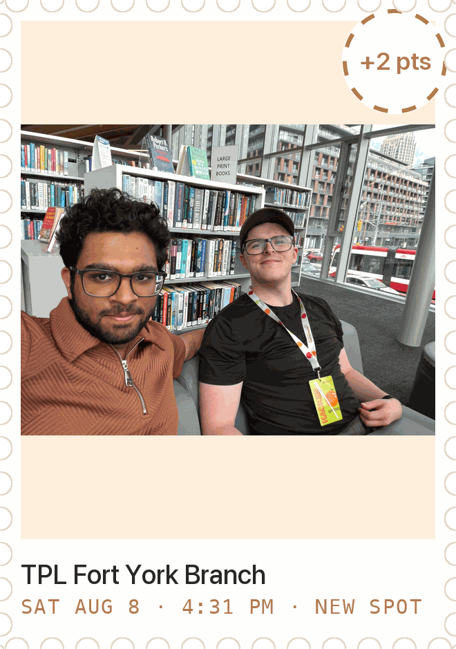
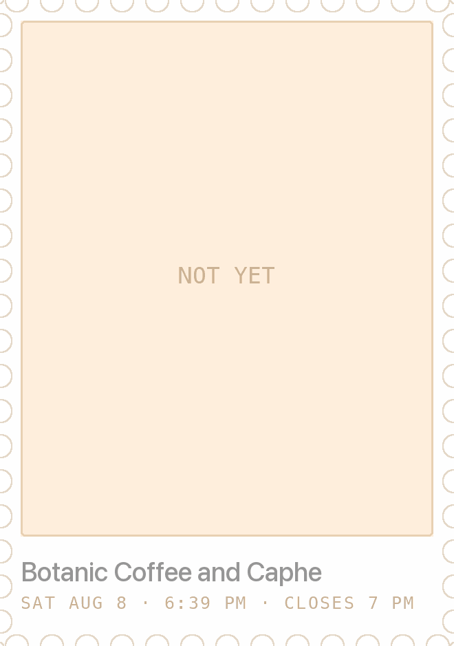
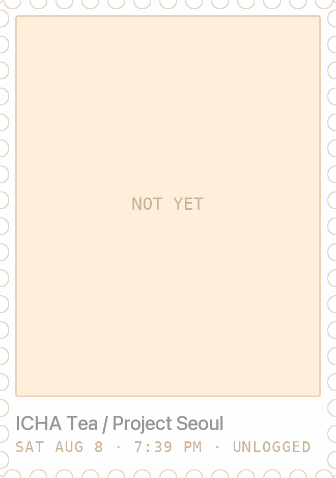
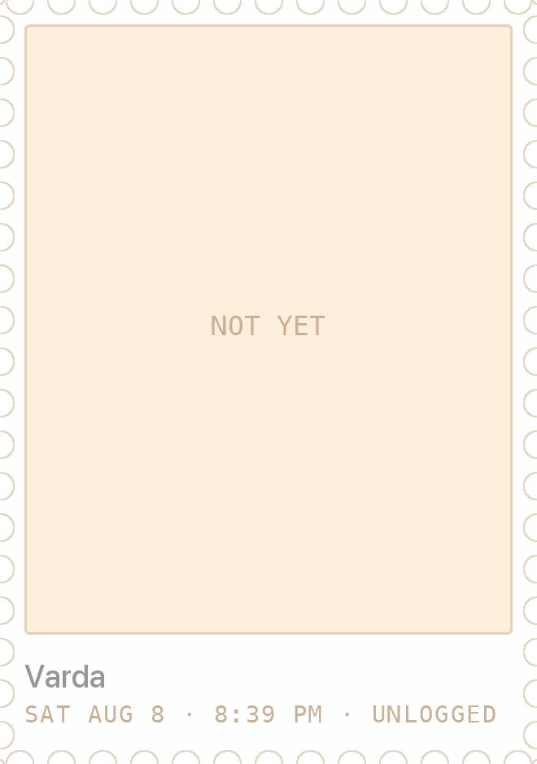

# The Third Space Trek

Side quest for SummerHacks 2026 — one photo per hour, nine spots on the list, 18 points on the board.

**Standing: 🥇 #1 · 13 pts · 6 spots · 7 photos.** Second place (AEIOU) is on 12 — one photo behind.
Next photo unlocks **6:39 PM**. Team code `FTA8PD` — Alaqmar, Connor.

  

---

## The photos

<table>
<tr>
<td width="25%"></td>
<td width="25%"></td>
<td width="25%"></td>
<td width="25%"></td>
</tr>
<tr>
<td></td>
<td></td>
<td></td>
<td></td>
</tr>
</table>

Three spots left, all cafés, all worth 2:

<table>
<tr>
<td width="33%"></td>
<td width="33%"></td>
<td width="33%"></td>
</tr>
</table>

> Everyone in frame, lanyards visible, or it doesn't count. Organizers review every photo after
> standings lock.
>
> To add one: drop the shot in `docs/assets/photos/` as `HHMM-slug.jpg`, move its row from
> `PENDING` to `PHOTOS` in [`scripts/make-stamps.py`](../scripts/make-stamps.py), and run
> `python3 scripts/make-stamps.py`. The frame, crop, badge and caption are all generated —
> the stamp border is lifted from the portal's own `.trek-stamp` so the log matches the site.

---

## The route

  

## Schedule

| Time | Stop | Where | Cost | Pts | Closes | Getting there |
|---|---|---|---|---:|---|---|
| ~~11:17~~ | ~~Milky's Cloud Room~~ | Inside Stackt | Purchase | ✅ 2 | — | — |
| ~~12:21~~ | ~~Fungo Cafe~~ | King St W | Purchase | ✅ 2 | — | — |
| ~~1:24~~ | ~~Waterworks / The Well~~ | Richmond & Brant | Free | ✅ 2 | — | — |
| ~~2:25~~ | ~~Scadding Court Community Ctr~~ | Bathurst & Dundas | Free | ✅ 2 | — | — |
| ~~3:26~~ | ~~TPL Lillian H. Smith~~ | College & Spadina | Free | ✅ 2 | — | — |
| ~~4:31~~ | ~~TPL Fort York Branch~~ | Fort York Blvd | Free | ✅ 2 | — | — |
| ~~5:39~~ | ~~The Studio~~ | Inside Stackt — our room | Free | ✅ 1 | — | — |
| **6:39** | **Botanic Coffee and Caphe** | 662 Queen St W | Purchase | 2 | **7 PM** | 12 min walk |
| 7:39 | ICHA Tea / Project Seoul / Cafe Foret | 235 Spadina | Purchase | 2 | 10 PM | ~10 min |
| 8:39 | Varda | 350 King St W (TIFF) | Purchase | 2 | 10 PM | ~10 min |

**13 banked · 6 still on the table · three cafés, all within a streetcar hop.**

Saturday hours checked against each venue's own listing — Botanic 8 AM–7 PM (their Instagram bio),
ICHA 11:30 AM–10 PM (their Facebook), Varda 11 AM–10 PM ([tiff.net](https://tiff.net/varda)). All
three are open at the slots above; Botanic is the only one without slack.

Note the clock drifted all day: the hourly lock runs off the last submission, so the slot moved
11:17 → 12:21 → 1:24 → 2:25 → 3:26 → 4:31 → 5:39. The portal says the next one opens at **6:39** —
don't queue up early, the button won't take it.

## Scoring, as the portal actually counts it

- **New spot — 2 pts.** Anywhere on the list the team hasn't logged yet. "Purchase" is about the
  table, not the score; a café you haven't logged is still worth the full 2.
- **Repeat spot — 1 pt.** Somewhere already logged.
- **Off-list — 1 pt.** Counts, but never earns the discovery bonus.
- **One scoring photo per hour, per team.** The cadence is the ceiling, not the map.

Three unlogged spots remain, so the list tops out at 19 for us — 13 banked plus 6. Everything still
on the list is worth 2, so there's no reason to repeat a spot while new ones are open.

## The Studio is the floor, and it's free

**The Studio is our own room at Stackt — the hall the hackathon is running in.** It isn't on the
portal's list, so it only scores as an off-list spot: **+1 pt, from the chair we're already sitting
in.** That's what 5:39 was.

It changes the shape of the rest of the night. The downside of any hour is no longer zero — if a
café is packed, or a leg runs long, or we're mid-merge and nobody wants to move, we take the photo
where we sit and still bank a point. **Never let an hour lapse empty.** A +1 costs nothing but the
30 seconds to line up the shot, and AEIOU is one photo behind us.

The corollary: don't spend a *good* hour on it. While list spots are open they're worth double, so
The Studio is the fallback, never the plan.

## Why this order

Distance stopped mattering — everything left is one streetcar hop. **Closing times decide it, and
there's exactly one hard call:**

- **Botanic closes at 7 PM, and 6:39 is the last slot before it — 21 minutes of margin, total.**
  This is the same call Fort York was at 4:26, and it's tighter.

  **Go now, don't leave at 6:25.** The walk is 12 min, so leaving immediately puts you there
  around 6:20 with a table and a drink already bought when the button unlocks at 6:39. Waiting
  until 6:25 means walking in at 6:37 and shooting in a café that's closing up behind you — and
  any slip at all loses the spot for the weekend.
- **ICHA and Varda both run to 10 PM,** so they're safe in either order. Geography picks it:
  Queen → Spadina → King is one continuous sweep, and it ends at Varda, back near the venue.
- **If 6:39 slips, take The Studio instead and go to Botanic at 7:39 — Sunday morning.** Losing the
  photo is worse than losing the café.

**Best build block:** now until ~6:25 here at The Studio, then Botanic until close — the run east
is three photos in three hours with a real table under us for most of it.

## Sunday fallback

Only the three cafés are still open to us, and all three keep Sunday hours against the 1 PM
submission cutoff. Botanic is the one at risk tonight; if it slips, it's the first stop Sunday.
Every Sunday hour we're still on-site is also a free +1 at The Studio.
