# The Third Space Trek

[Overview](../README.md) · [Plan](PLAN.md) · [Devpost](devpost.md) · [Reve playbook](reve-playbook.md) · [Reve prompts](reve-prompts-used.md) · **Third Space Trek**

Side quest for SummerHacks 2026 — one photo per hour, nine spots on the list.

**Final: 🥈 #2 · 19 pts · 6 spots · 13 photos.** Standings are locked. `strawberry soda` took it on
**20** with all nine spots logged; AEIOU third on 16. Team code `FTA8PD` — Alaqmar, Connor.

**We lost by one point, with six sitting unclaimed in three cafés.** The hunt closed at midnight
Saturday. Botanic, Varda and ICHA were all open during the evening and none of them got logged —
any single one would have won it. See [Where the point went](#where-the-point-went).

  

---

## The photos

<table>
<tr>
<td width="25%"></td>
<td width="25%">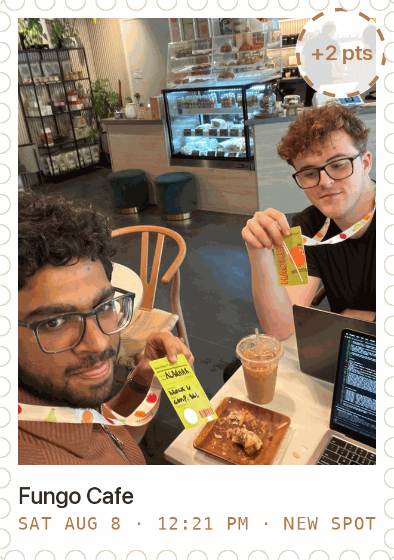</td>
<td width="25%"></td>
<td width="25%"></td>
</tr>
<tr>
<td>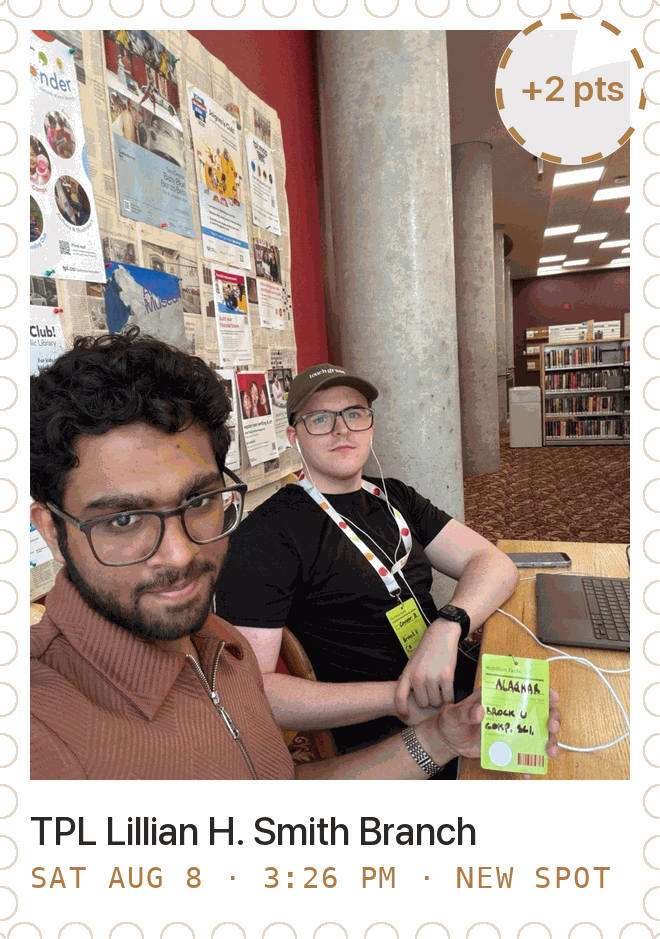</td>
<td></td>
<td>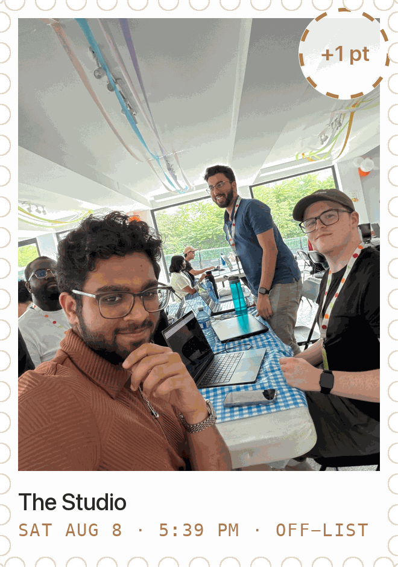</td>
<td>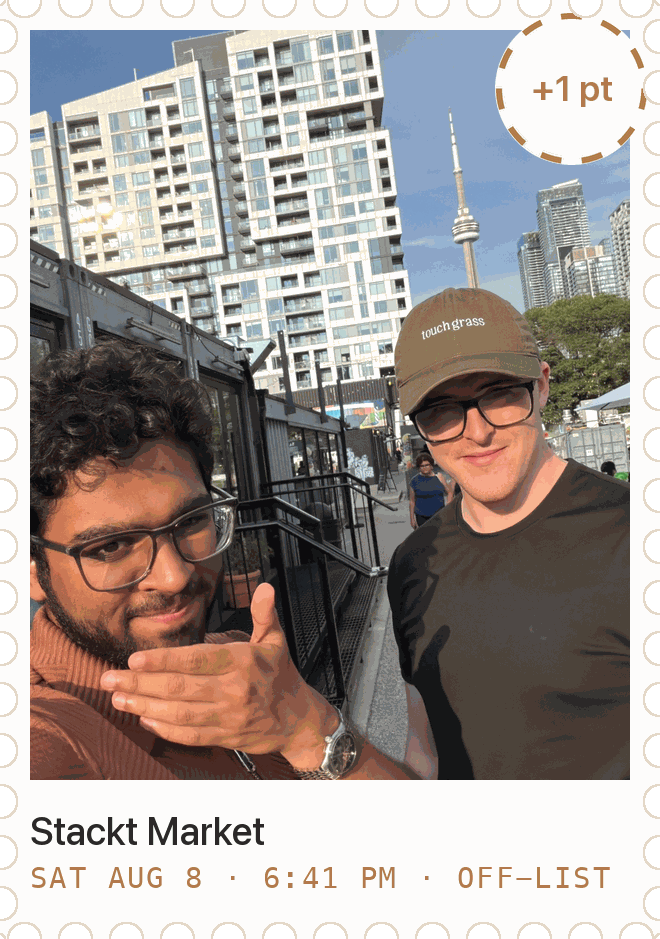</td>
</tr>
<tr>
<td>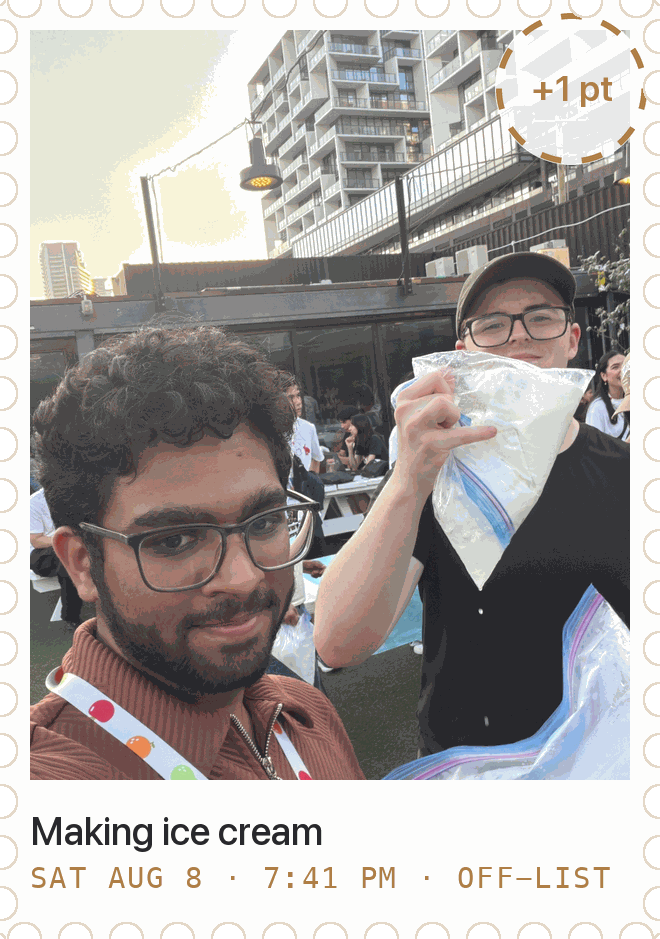</td>
<td>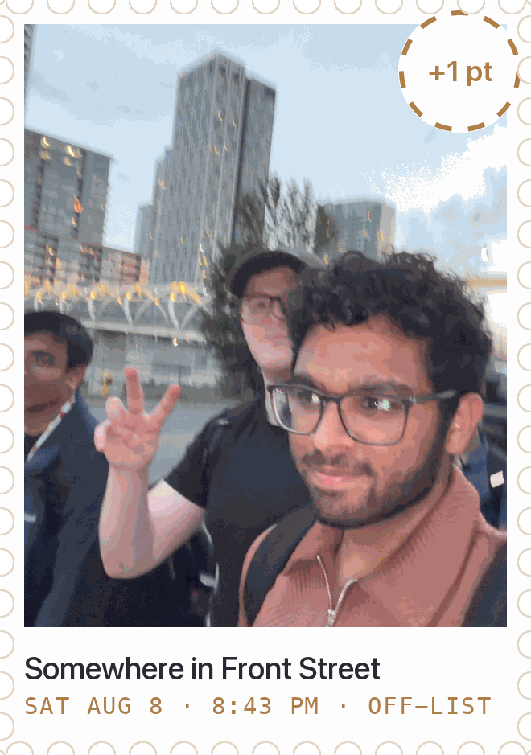</td>
<td>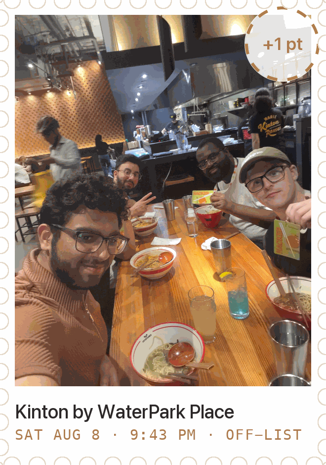</td>
<td>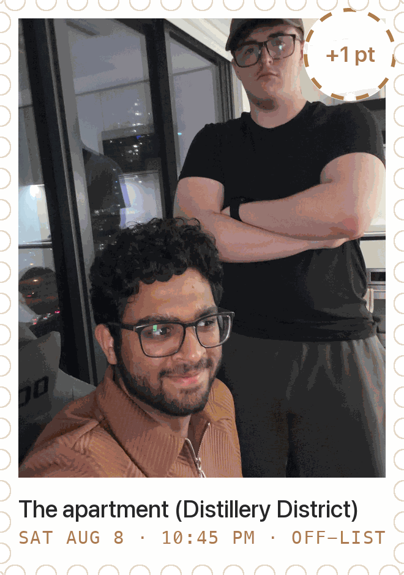</td>
</tr>
<tr>
<td>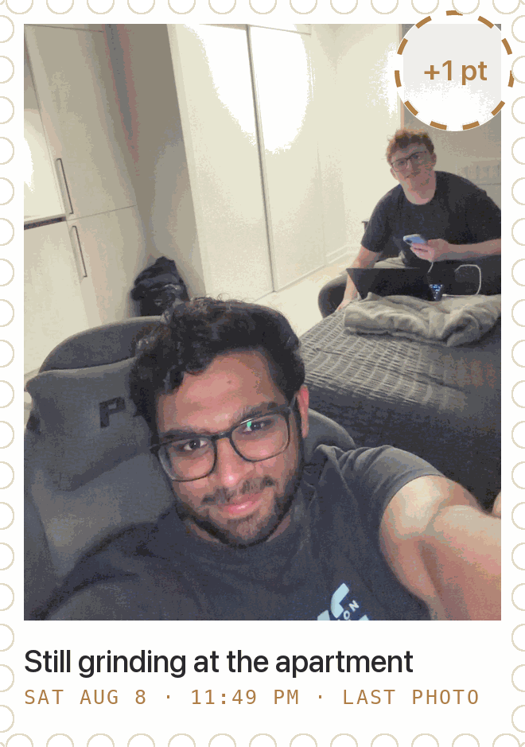</td>
<td></td><td></td><td></td>
</tr>
</table>

The three that never got taken, worth 2 each:

<table>
<tr>
<td width="33%">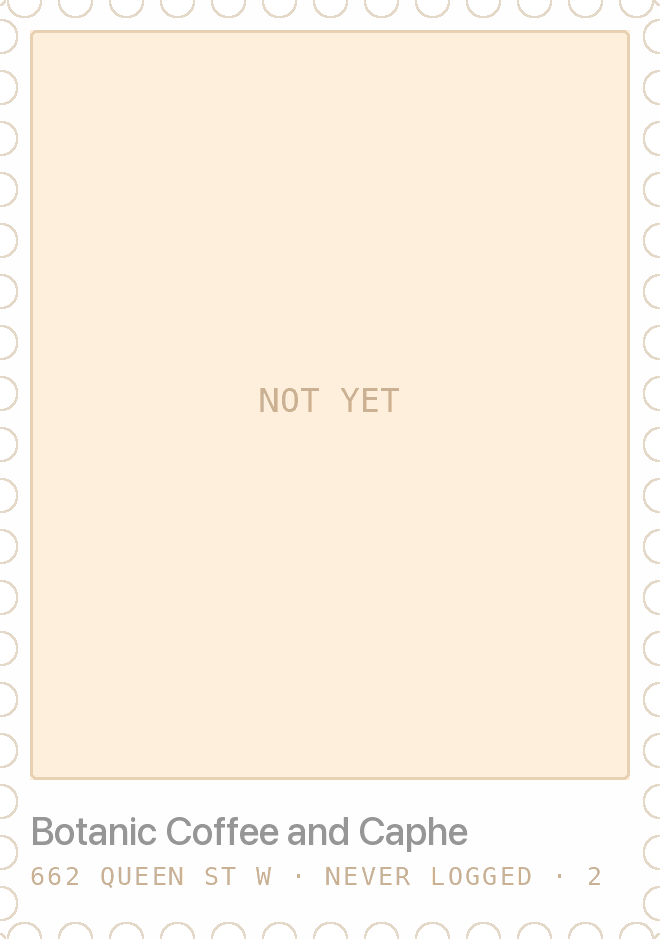</td>
<td width="33%">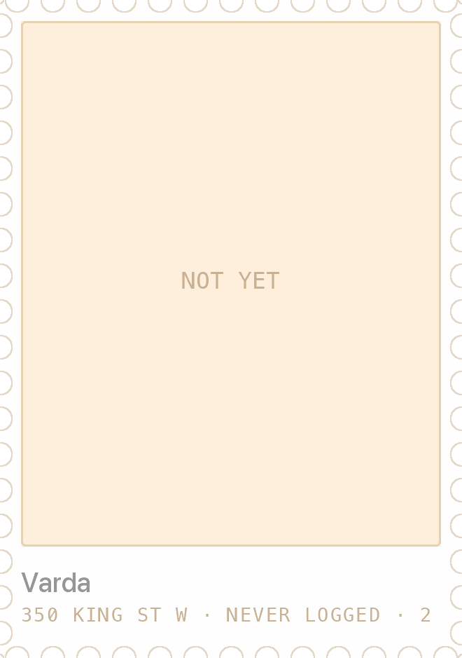</td>
<td width="33%">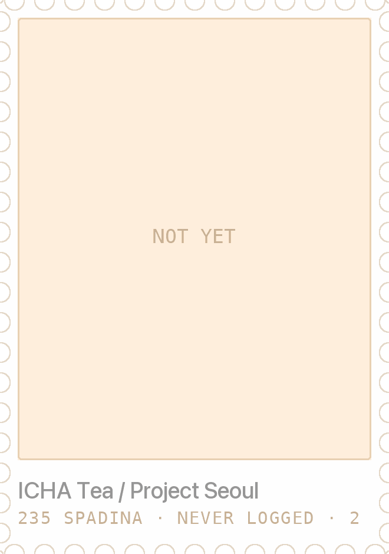</td>
</tr>
</table>

> Everyone in frame, lanyards visible, or it doesn't count. Organizers are reviewing every photo now
> that standings have locked.
>
> The log is generated: drop a shot in `docs/assets/photos/` as `HHMM-slug.jpg` (24-hour), add its
> row to `PHOTOS` in [`scripts/make-stamps.py`](../scripts/make-stamps.py), and run
> `python3 scripts/make-stamps.py`. Frame, crop, badge and caption are all derived — the badge reads
> `+2 pts` when the caption contains `new spot`, `+1 pt` otherwise. The stamp border is lifted from
> the portal's own `.trek-stamp` so the log matches the site.

---

## Where the point went

Final margin: **20 – 19**. The three cafés we never logged were worth **6**.

We led at 5:39 PM on 13 points. From there the cadence never lapsed — seven straight hourly photos,
right up to 11:49 PM, eleven minutes before the hunt closed. Not one of them was a new spot.

**A +1 is only free when there's no 2 available in the same hour.** There were three 2s open for
most of that evening, and every one of them was reachable from where we already were:

| Hour | What we shot | What was open, and how far |
|---|---|---|
| 5:39 PM | The Studio | Botanic — 12 min walk, open until 7 |
| 6:41 PM | Stackt Market | Botanic — same walk, still 19 min of margin |
| 7:41 PM | Making ice cream | Varda and ICHA, both until 10 |
| 8:43 PM | Somewhere in Front Street | **Varda — a few minutes north on King** |
| 9:43 PM | Kinton, WaterPark Place | Varda — still closer than the ride home was |

The 8:43 slot is the sharpest one. Front Street and 350 King St W are a short walk apart, the photo
was taken outdoors on the way past, and Varda had another 75 minutes of trading left. That single
substitution is a two-point swing and the trek is won.

**Four of our thirteen photos never left Stackt** (Milky's, The Studio, Stackt Market, ice cream),
and the last two were both the same apartment. The route map shows it: a tight, productive western
loop until 4:31, then a straight drift east, away from all three remaining spots.

`strawberry soda` won by doing the opposite — nine spots in eleven photos, closing out the entire
list. They finished with **fewer photos than us** and two more points, which is the whole lesson in
one line: the cadence was never the constraint, the map was.

## Saturday's route

  

## The log

| Time | Stop | Where | Cost | Pts |
|---|---|---|---|---:|
| 11:17 AM | Milky's Cloud Room | Inside Stackt | Purchase | 2 |
| 12:21 PM | Fungo Cafe | King St W | Purchase | 2 |
| 1:24 PM | Waterworks / The Well | Richmond & Brant | Free | 2 |
| 2:25 PM | Scadding Court Community Ctr | Bathurst & Dundas | Free | 2 |
| 3:26 PM | TPL Lillian H. Smith | College & Spadina | Free | 2 |
| 4:31 PM | TPL Fort York Branch | Fort York Blvd | Free | 2 |
| 5:39 PM | The Studio | Inside Stackt — our room | Free | 1 |
| 6:41 PM | Stackt Market | Our own venue | Free | 1 |
| 7:41 PM | Making ice cream | Stackt — hackathon activity | Free | 1 |
| 8:43 PM | Somewhere in Front Street | Front St W | Free | 1 |
| 9:43 PM | Kinton by WaterPark Place | Queens Quay / Bay | Purchase | 1 |
| 10:45 PM | The apartment | Distillery District | Free | 1 |
| 11:49 PM | Still grinding at the apartment | Distillery District | Free | 1 |

**19 final · 6 never claimed.**

| Never logged | Where | Open Saturday | Worth |
|---|---|---|---:|
| Botanic Coffee and Caphe | 662 Queen St W | 8 AM – 7 PM | 2 |
| Varda | 350 King St W (TIFF) | 11 AM – 10 PM | 2 |
| ICHA Tea / Project Seoul / Cafe Foret | 235 Spadina | 11:30 AM – 10 PM | 2 |

The portal treats ICHA / Project Seoul / Cafe Foret as **one** spot, so any of the three would have
counted for that 2.

The hourly lock runs off the last submission, so the slot drifted all day:
11:17 → 12:21 → 1:24 → 2:25 → 3:26 → 4:31 → 5:39 → 6:41 → 7:41 → 8:43 → 9:43 → 10:45 → 11:49.
The hunt closed at midnight; 11:49 PM was the last slot we could reach.

## Scoring, as the portal actually counts it

- **New spot — 2 pts.** Anywhere on the list the team hasn't logged yet. "Purchase" is about the
  table, not the score; a café you haven't logged is still worth the full 2.
- **Repeat spot — 1 pt.** Somewhere already logged. The list page now shows all six of ours as
  `Logged · 1 pt`.
- **Off-list — 1 pt.** Counts, but never earns the discovery bonus.
- **One scoring photo per hour, per team.** The cadence is the ceiling, not the map.

Six spots × 2 = 12, plus seven 1-pointers = **19**. The three cafés were the only 2s still available
to us, and they expired with the hunt at midnight.

## Final standings

| # | Team | Spots | Photos | Pts |
|---:|---|---:|---:|---:|
| 1 | strawberry soda | 9 | 11 | **20** |
| 2 | **Git Out of Town** | 6 | 13 | **19** |
| 3 | AEIOU | 7 | 9 | 16 |
| 4 | tall dark and handsome | 4 | 6 | 10 |
| 5 | Ema & Andy | 2 | 5 | 7 |

Standings are locked and organizers are reviewing every photo for validity, so the final number can
still move if any shot is thrown out. Two photos separated first from second, and both of them were
sitting in cafés we walked past.
